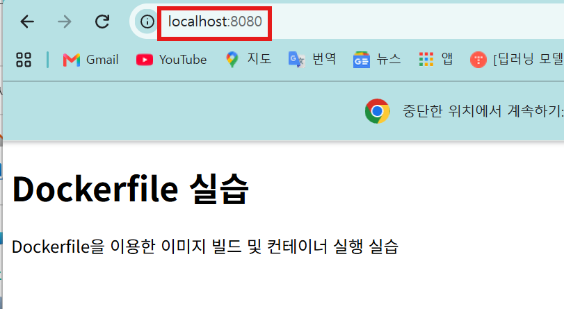
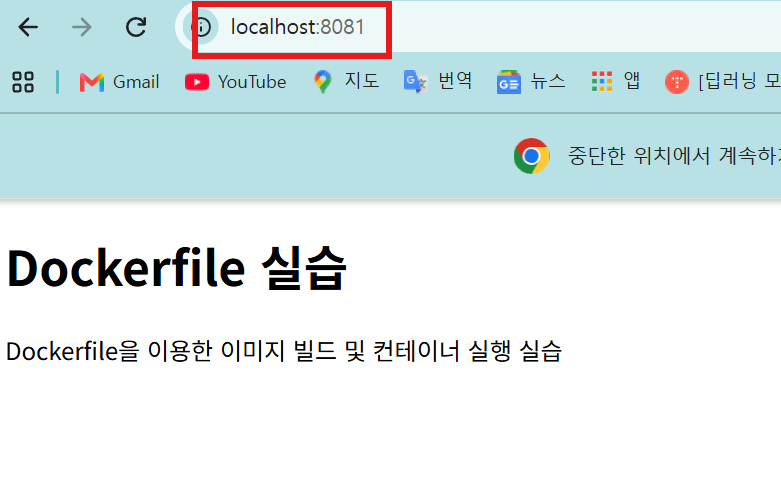

# Codyssey E1-1 개발 워크스테이션 구축

## 1. 프로젝트 개요

터미널, Docker, Git 세 가지 핵심 도구를 직접 설치하고 운영하며
개발 워크스테이션을 구축하는 미션이다.

### 미션 목표
- 리눅스 CLI(터미널)로 파일 시스템을 조작할 수 있다
- Docker로 컨테이너를 실행하고 관리할 수 있다
- Dockerfile로 커스텀 이미지를 제작할 수 있다
- Git/GitHub으로 버전 관리 및 협업 환경을 구성할 수 있다

## 2. 실행 환경
- OS: Windows 11 (캠퍼스 실습실 PC)
- Shell / Terminal
  - Git Bash (MSYS2 기반 리눅스 CLI 에뮬레이터): 4-1 터미널 조작, 트러블슈팅 Case 1
  - WSL2 Ubuntu (bash): 4-2 권한 실습
  - PowerShell: WSL 설치, 4-3 이후 Docker 명령
- WSL2 Ubuntu: (버전 확인 후 기입, `cat /etc/os-release`)
- Docker: Docker Desktop 4.98.0 (Engine 29.9.2, WSL2 백엔드)
- Git: 2.56.0.windows.4
- Visual Studio Code: 1.144.0

실습실 자리마다 설치된 버전이 다를 수 있다. 위 버전은 로그를 기록한 PC 기준이다.
새 PC에서는 [setup.bat](./setup.bat)으로 Git, VSCode, Docker Desktop, WSL Ubuntu를 설치하거나 업데이트할 수 있다.

## 3. 수행 항목 체크리스트
- [x] 터미널 기본 조작
- [x] 권한 변경 실습
- [x] Docker 설치/점검
- [x] Docker 기본 운영 (이미지/컨테이너/로그/리소스)
- [x] 컨테이너 실행 실습 (hello-world, ubuntu)
- [x] Dockerfile 빌드/실행
- [x] 포트 매핑 접속
- [ ] 바인드 마운트
- [ ] 볼륨 영속성
- [ ] Git 설정 + GitHub 연동

## 4. 검증 방법

### 4-1. 터미널 기본 조작 실습 (Git Bash)

D 드라이브(`/d`)에서 진행했다. D 드라이브가 없는 환경에서는 홈 디렉토리(`~`) 등 원하는 위치에서 같은 절차로 진행하면 된다.

```bash
# 현재 위치 확인
$ pwd
/c/Users/<사용자명>

# 작업 위치 이동
$ cd /d
$ pwd
/d

# 실습 디렉토리 생성 및 이동
$ mkdir practice
$ cd practice
$ pwd
/d/practice

# 숨김 디렉토리 생성 후 ls / ls -a 비교
$ mkdir .hidden
# ls: 숨김 항목이 표시되지 않음
$ ls
# ls -a: 숨김 항목(.hidden/)까지 표시됨
$ ls -a
./  ../  .hidden/

# 빈 파일 생성
$ touch hello.txt
$ ls
hello.txt

# 파일 복사
$ cp hello.txt hello2.txt
$ ls
hello.txt  hello2.txt

# 빈 파일 내용 확인 (touch로 만든 파일이라 출력 없음, cat hello.txt 명령은 아무 출력도 없음)
$ cat hello.txt

# 내용 있는 파일 생성 및 확인
$ echo "파일테스트" > test.txt
$ cat test.txt
파일테스트

# 파일 이름 변경
$ mv hello2.txt hello2-rename.txt
$ ls
hello.txt  hello2-rename.txt  test.txt

# 파일 이동
$ mkdir mv-test
$ ls
hello.txt  hello2-rename.txt  mv-test/  test.txt

$ mv hello.txt mv-test/
$ ls
hello2-rename.txt  mv-test/  test.txt
$ ls mv-test/
hello.txt

# 상대경로와 절대경로 비교
# /d/practice에서 상대경로로 이동 → 성공
$ cd mv-test
$ pwd
/d/practice/mv-test

# 홈으로 이동 후 같은 상대경로 → 실패
$ cd ~
$ cd mv-test
bash: cd: mv-test: No such file or directory

# 홈에서 절대경로로 이동 → 성공
$ cd /d/practice/mv-test
$ pwd
/d/practice/mv-test

# 실습 폴더로 복귀
$ cd ..
$ pwd
/d/practice

# 파일 삭제
$ rm hello2-rename.txt
$ ls
mv-test/  test.txt

# 디렉토리 삭제 (안에 파일이 있는 경우)
$ rmdir mv-test
rmdir: failed to remove 'mv-test': Directory not empty
$ rm -r mv-test
$ ls
test.txt

# 나머지 항목 삭제
$ ls -a
./  ../  .hidden/  test.txt
$ rmdir .hidden
$ rm test.txt
$ ls -a
./  ../
```

절대경로는 `/`부터 시작해 어디서 실행해도 같은 위치를 가리킨다. 상대경로는 현재 위치를 기준으로 해석되므로, `/d/practice`에서는 성공한 `cd mv-test`가 홈에서는 실패했다.

### 4-2. 권한 변경 실습 (WSL2 Ubuntu)

Git Bash에서는 chmod가 제대로 반영되지 않아 이 실습은 WSL2 Ubuntu에서 진행했다. 원인은 [트러블슈팅 Case 1](#case-1-git-bash에서-chmod가-반영되지-않음) 참고.
Windows 드라이브(`/mnt/d`)도 NTFS라 같은 문제가 있어서, Ubuntu 홈 디렉토리에서 실습했다.

```powershell
# PowerShell에서 Ubuntu 설치 및 실행
PS> wsl --install Ubuntu
PS> wsl -d Ubuntu
```

```bash
# 홈 디렉토리로 이동
$ cd ~
$ pwd
/home/<사용자명>

# 실습 파일 및 디렉토리 생성
$ mkdir auth_dir
$ touch auth_file.txt
$ ls -l
total 4
drwxr-xr-x 2 <사용자명> <사용자명> 4096 Nov  4 21:28 auth_dir
-rw-r--r-- 1 <사용자명> <사용자명>    0 Nov  4 21:28 auth_file.txt

# 권한 변경
$ chmod 756 auth_dir
$ chmod 475 auth_file.txt
$ ls -l
total 4
drwxr-xrw- 2 <사용자명> <사용자명> 4096 Nov  4 21:28 auth_dir
-r--rwxr-x 1 <사용자명> <사용자명>    0 Nov  4 21:28 auth_file.txt
```

#### chmod 개념 정리

chmod(change mode)는 파일과 디렉토리의 권한을 바꾸는 명령이다.

- 권한 종류: r(read), w(write), x(execute)
- 한 자리 숫자는 rwx를 3비트로 본 값이다. r=4, w=2, x=1을 더하며, 예를 들어 7은 111(rwx), 5는 101(r-x)이다.
- 숫자 세 자리는 순서대로 소유자, 그룹, 그 외 사용자의 권한이다. 따라서 9비트로 000부터 777까지 표현한다.
- 이번 실습의 756은 rwxr-xrw-, 475는 r--rwxr-x가 된다.

### 4-3. Docker 설치/점검

1. Docker Desktop for Windows 설치
   공식 설치 파일로 설치했다. 설치 과정에서 Windows 기능인 WSL2가 활성화되고 Docker 전용 배포판 `docker-desktop`이 생성된다. 실습용 Ubuntu는 4-2에서 별도로 설치했다.

```powershell
PS> wsl -l -v
  NAME              STATE           VERSION
* docker-desktop    Stopped         2
  Ubuntu            Stopped         2
```

2. Docker 엔진 구동
   `docker-desktop`이 Stopped 상태라 Docker Desktop 앱을 실행하고 왼쪽 아래 Resume 버튼으로 엔진을 켰다.

```powershell
PS> wsl -l -v
  NAME              STATE           VERSION
* docker-desktop    Running         2
  Ubuntu            Stopped         2
```

3. 버전 확인 (`-v`는 `--version`의 축약)

```powershell
PS> docker -v
Docker version 29.9.2, build a82e528
```

4. 데몬 동작 확인

```powershell
# 출력 발췌
PS> docker info
Client:
 Version:    29.9.2
 Context:    desktop-linux

Server:
 Containers: 0
 Images: 0
 Server Version: 29.9.2
 Kernel Version: 6.18.54.1-microsoft-standard-WSL2
 Operating System: Docker Desktop
 OSType: linux
 Name: docker-desktop
```

`Server:` 부분이 정상 출력되면 데몬이 동작 중이다. 데몬이 멈춘 상태의 결과는 [트러블슈팅 Case 2](#case-2-docker-info에서-server-부분-에러) 참고.

### 4-4. Docker 기본 운영 (이미지/컨테이너/로그/리소스)

```powershell
# 이미지 다운로드 전
PS> docker images
IMAGE   ID             DISK USAGE   CONTENT SIZE   EXTRA

# 이미지 다운로드
PS> docker pull nginx
Using default tag: latest
latest: Pulling from library/nginx
a670537bed70: Pull complete
6fc242d221a6: Pull complete
a071113ac575: Pull complete
c139fe92686d: Pull complete
d322f1bf41d8: Pull complete
9f604dae09b2: Pull complete
6e2ab1f3ef4e: Pull complete
05a7d8870b4b: Download complete
ca81da665177: Download complete
Digest: sha256:5ab5b0b01097420873a3f3330f44248e34a3c2a3e8d5ee30658aeae8cb7435da
Status: Downloaded newer image for nginx:latest
docker.io/library/nginx:latest

# 이미지 다운로드 후
PS> docker images
IMAGE          ID             DISK USAGE   CONTENT SIZE   EXTRA
nginx:latest   5ab5b0b01097        243MB         66.8MB

# 실행 중인 컨테이너 목록
PS> docker ps
CONTAINER ID   IMAGE     COMMAND   CREATED   STATUS    PORTS     NAMES

# 컨테이너 실행 (백그라운드 실행, 이름 지정)
PS> docker run -d --name test nginx
44cf8c1df6c9a1c9ee7580e687dcc0cbb6d14b95a35fa0bed0b4039a28185c99
PS> docker ps
CONTAINER ID   IMAGE     COMMAND                   CREATED          STATUS          PORTS     NAMES
44cf8c1df6c9   nginx     "/docker-entrypoint.…"   12 seconds ago   Up 11 seconds   80/tcp    test

# 컨테이너 로그 확인
PS> docker logs test
/docker-entrypoint.sh: /docker-entrypoint.d/ is not empty, will attempt to perform configuration
/docker-entrypoint.sh: Looking for shell scripts in /docker-entrypoint.d/
...
/docker-entrypoint.sh: Configuration complete; ready for start up
2026/11/05 05:13:23 [notice] 1#1: using the "epoll" event method
2026/11/05 05:13:23 [notice] 1#1: nginx/1.31.8
2026/11/05 05:13:23 [notice] 1#1: OS: Linux 6.18.54.1-microsoft-standard-WSL2
2026/11/05 05:13:23 [notice] 1#1: start worker processes
2026/11/05 05:13:23 [notice] 1#1: start worker process 29
...
2026/11/05 05:13:23 [notice] 1#1: start worker process 52

# 컨테이너 리소스 사용량 확인 (--no-stream: 실시간 갱신 없이 한 번만 출력)
PS> docker stats --no-stream
CONTAINER ID   NAME      CPU %     MEM USAGE / LIMIT     MEM %     NET I/O         BLOCK I/O         PIDS
44cf8c1df6c9   test      0.00%     23.22MiB / 15.25GiB   0.15%     1.17kB / 126B   14.6MB / 12.3kB   25

# 컨테이너 중지
PS> docker stop test
test
PS> docker ps
CONTAINER ID   IMAGE     COMMAND   CREATED   STATUS    PORTS     NAMES
PS> docker ps -a
CONTAINER ID   IMAGE     COMMAND                   CREATED          STATUS                      PORTS     NAMES
44cf8c1df6c9   nginx     "/docker-entrypoint.…"   14 minutes ago   Exited (0) 52 seconds ago             test

# 컨테이너 삭제
PS> docker rm test
test
PS> docker ps -a
CONTAINER ID   IMAGE     COMMAND   CREATED   STATUS    PORTS     NAMES
```

`docker ps`는 실행 중인 컨테이너만, `docker ps -a`는 중지된 것을 포함해 삭제되지 않은 모든 컨테이너를 보여준다.

### 4-5. 컨테이너 실행 실습 (hello-world, ubuntu)

#### hello-world 실행

```powershell
# 로컬에 이미지가 없어 자동으로 pull 후 실행
PS> docker run hello-world
Unable to find image 'hello-world:latest' locally
latest: Pulling from library/hello-world
...
Status: Downloaded newer image for hello-world:latest

Hello from Docker!
This message shows that your installation appears to be working correctly.

To generate this message, Docker took the following steps:
 1. The Docker client contacted the Docker daemon.
 2. The Docker daemon pulled the "hello-world" image from the Docker Hub.
    (amd64)
 3. The Docker daemon created a new container from that image which runs the
    executable that produces the output you are currently reading.
 4. The Docker daemon streamed that output to the Docker client, which sent it
    to your terminal.
...

# 메시지를 출력하고 바로 정상 종료됨
PS> docker ps -a
CONTAINER ID   IMAGE         COMMAND    CREATED         STATUS                     PORTS     NAMES
b02ef7814360   hello-world   "/hello"   3 minutes ago   Exited (0) 3 minutes ago             upbeat_einstein

# 컨테이너 삭제
PS> docker rm b02ef7814360
b02ef7814360
PS> docker ps -a
CONTAINER ID   IMAGE     COMMAND   CREATED   STATUS    PORTS     NAMES
```

#### ubuntu 컨테이너 실행

```powershell
# -it 없이 실행 (로컬에 이미지가 없어 자동으로 pull 후 실행)
PS> docker run --name ubuntu_ex ubuntu
Unable to find image 'ubuntu:latest' locally
latest: Pulling from library/ubuntu
...
Status: Downloaded newer image for ubuntu:latest

# bash가 입력을 받지 못해 바로 종료됨
PS> docker ps -a
CONTAINER ID   IMAGE     COMMAND       CREATED         STATUS                     PORTS     NAMES
51de41c7bf4b   ubuntu    "/bin/bash"   3 minutes ago   Exited (0) 9 seconds ago             ubuntu_ex

PS> docker rm ubuntu_ex
ubuntu_ex

# -it로 다시 실행 (-i: 입력 전달, -t: 터미널 연결)
PS> docker run -it --name ubuntu_ex ubuntu
root@42be17745ffc:/# pwd
/
root@42be17745ffc:/# ls
bin  boot  dev  etc  home  lib  lib64  media  mnt  opt  proc  root  run  sbin  srv  sys  tmp  usr  var
root@42be17745ffc:/# echo "Hello World"
Hello World
root@42be17745ffc:/# exit
exit
```

#### attach와 exec 비교

```powershell
# attach: 주 프로세스(bash)에 직접 연결 → exit하면 컨테이너 종료
PS> docker start ubuntu_ex
ubuntu_ex
PS> docker attach ubuntu_ex
root@42be17745ffc:/# ls
bin  boot  dev  etc  home  lib  lib64  media  mnt  opt  proc  root  run  sbin  srv  sys  tmp  usr  var
root@42be17745ffc:/# exit
exit
PS> docker ps -a
CONTAINER ID   IMAGE     COMMAND       CREATED          STATUS                     PORTS     NAMES
42be17745ffc   ubuntu    "/bin/bash"   12 minutes ago   Exited (0) 4 seconds ago             ubuntu_ex

# exec: 새 bash 프로세스를 띄워 연결 → exit해도 컨테이너 유지
PS> docker start ubuntu_ex
ubuntu_ex
PS> docker exec -it ubuntu_ex bash
root@42be17745ffc:/# ls
bin  boot  dev  etc  home  lib  lib64  media  mnt  opt  proc  root  run  sbin  srv  sys  tmp  usr  var
root@42be17745ffc:/# exit
exit
PS> docker ps -a
CONTAINER ID   IMAGE     COMMAND       CREATED          STATUS          PORTS     NAMES
42be17745ffc   ubuntu    "/bin/bash"   12 minutes ago   Up 22 seconds             ubuntu_ex

# 정리
PS> docker stop ubuntu_ex
ubuntu_ex
PS> docker rm ubuntu_ex
ubuntu_ex
PS> docker ps -a
CONTAINER ID   IMAGE     COMMAND   CREATED   STATUS    PORTS     NAMES
```

attach는 컨테이너의 주 프로세스에 터미널을 연결한다. 그래서 exit하면 주 프로세스가 끝나고 컨테이너도 종료된다.
exec은 실행 중인 컨테이너 안에 새 프로세스를 띄워 연결한다. exit하면 그 프로세스만 끝나고 주 프로세스는 남아 있어 컨테이너가 유지된다.

### 4-6. Dockerfile 커스텀 이미지 제작

#### 베이스 이미지
(A) 방식으로 `nginx` 공식 이미지를 베이스로 선택했다. 실행만 하면 웹 서버가 바로 뜨고, HTML을 읽는 폴더(`/usr/share/nginx/html/`)가 정해져 있어 정적 페이지만 교체하면 된다.

#### 파일 구성
```
Codyssey_1-1/
├── Dockerfile
└── web/
    └── index.html
```
- [Dockerfile](./Dockerfile)
- [web/index.html](./web/index.html)

#### Dockerfile
```dockerfile
FROM nginx
LABEL org.opencontainers.image.title="My Nginx Web Server"
LABEL org.opencontainers.image.description="A simple Nginx web server."
LABEL org.opencontainers.image.authors="Wooseong Yeo"
COPY ./web /usr/share/nginx/html/
```

| 지시어 | 목적 |
|---|---|
| `FROM nginx` | NGINX 공식 이미지를 베이스로 사용 |
| `LABEL ...` | 이미지 이름, 설명, 작성자를 메타데이터로 기록해 `docker inspect`로 확인할 수 있게 함 |
| `COPY ./web /usr/share/nginx/html/` | NGINX 기본 페이지를 직접 작성한 `index.html`로 교체 |

#### 빌드
```powershell
# 빌드 컨텍스트는 Dockerfile이 있는 현재 폴더(.)
PS> docker build -t my-web:1.0 .
[+] Building 7.4s (8/8) FINISHED
 => [internal] load build definition from Dockerfile
 => [1/2] FROM docker.io/library/nginx:latest@sha256:5ab5b0b0...
 => [2/2] COPY ./web /usr/share/nginx/html/
 => exporting to image
 => => naming to docker.io/library/my-web:1.0

PS> docker images
IMAGE           ID             DISK USAGE   CONTENT SIZE   EXTRA
my-web:1.0      a9ab69b12fc7        241MB         63.9MB
ubuntu:latest   6a06111c3b0a        163MB         45.9MB
```

#### LABEL 적용 확인
```powershell
# 출력 발췌
PS> docker inspect my-web:1.0
        "RepoTags": [
            "my-web:1.0"
        ],
            "Labels": {
                "maintainer": "NGINX Docker Maintainers <docker-maint@nginx.com>",
                "org.opencontainers.image.authors": "Wooseong Yeo",
                "org.opencontainers.image.description": "A simple Nginx web server.",
                "org.opencontainers.image.title": "My Nginx Web Server"
            },
```
직접 추가한 LABEL 세 개가 들어갔고, `maintainer`는 베이스 이미지(nginx)에서 물려받은 값이다.

#### 실행
```powershell
PS> docker run -d --name my-web my-web:1.0
7ac75f50d3b5a0618599ba59c7a6e7b2cc28484a0151e09ea16019c671e0e020
PS> docker ps
CONTAINER ID   IMAGE        COMMAND                   CREATED         STATUS         PORTS     NAMES
7ac75f50d3b5   my-web:1.0   "/docker-entrypoint.…"   4 seconds ago   Up 3 seconds   80/tcp    my-web
```

### 4-7. 포트 매핑 접속

컨테이너는 자기만의 네트워크와 포트를 가지고 있어 외부에서 바로 접근할 수 없다. `-p 호스트포트:컨테이너포트`로 내 PC의 포트를 컨테이너 포트에 연결해야 브라우저에서 접속할 수 있다.

#### 8080 → 80

```powershell
PS> docker run -d -p 8080:80 --name my-web-8080 my-web:1.0
135fc624efcccda171c61ac90e97e65e32545a8d2cb723bdb238fef26f5fe9b6

# 포트를 연결하지 않은 my-web과 PORTS 칸 비교
PS> docker ps
CONTAINER ID   IMAGE        COMMAND                   CREATED          STATUS          PORTS                                     NAMES
135fc624efcc   my-web:1.0   "/docker-entrypoint.…"   10 seconds ago   Up 9 seconds    0.0.0.0:8080->80/tcp, [::]:8080->80/tcp   my-web-8080
7ac75f50d3b5   my-web:1.0   "/docker-entrypoint.…"   27 minutes ago   Up 27 minutes   80/tcp                                    my-web

PS> curl.exe http://localhost:8080
<!DOCTYPE html>
<html lang="ko">
<head>
  <meta charset="UTF-8">
  <title>Dockerfile실습</title>
</head>
<body>
    <div>
        <h1>Dockerfile 실습</h1>
        <p>Dockerfile을 이용한 이미지 빌드 및 컨테이너 실행 실습</p>
    </div>
</body>
</html>
```



#### 8081 → 80

```powershell
PS> docker run -d -p 8081:80 --name my-web-8081 my-web:1.0
f63c25d3ea2292f1d56d181bf5b689d3a3f7b63ec4c69b0076c3c100424e7206

# 같은 이미지로 띄운 세 컨테이너의 PORTS 비교
PS> docker ps
CONTAINER ID   IMAGE        COMMAND                   CREATED          STATUS          PORTS                                     NAMES
f63c25d3ea22   my-web:1.0   "/docker-entrypoint.…"   3 seconds ago    Up 3 seconds    0.0.0.0:8081->80/tcp, [::]:8081->80/tcp   my-web-8081
135fc624efcc   my-web:1.0   "/docker-entrypoint.…"   12 minutes ago   Up 12 minutes   0.0.0.0:8080->80/tcp, [::]:8080->80/tcp   my-web-8080
7ac75f50d3b5   my-web:1.0   "/docker-entrypoint.…"   39 minutes ago   Up 39 minutes   80/tcp                                    my-web

PS> curl.exe http://localhost:8081
<!DOCTYPE html>
<html lang="ko">
<head>
  <meta charset="UTF-8">
  <title>Dockerfile실습</title>
</head>
<body>
    <div>
        <h1>Dockerfile 실습</h1>
        <p>Dockerfile을 이용한 이미지 빌드 및 컨테이너 실행 실습</p>
    </div>
</body>
</html>
```



같은 이미지로 띄운 컨테이너들이 각자 자기 80번 포트를 쓰고, 내 PC 쪽 포트(8080, 8081)만 다르게 연결해 충돌 없이 둘 다 접속된다. 포트를 연결하지 않은 `my-web`은 컨테이너 안에서는 동작하지만 외부에서 접속할 수 없다.

```powershell

다음 실습 전 모든 컨테이너 삭제
```powershell
PS> docker rm -f $(docker ps -aq)
f63c25d3ea22
135fc624efcc
7ac75f50d3b5
PS> docker ps -a
CONTAINER ID   IMAGE     COMMAND   CREATED   STATUS    PORTS     NAMES
```powershell

## 5. 트러블슈팅

### Case 1. Git Bash에서 chmod가 반영되지 않음

**문제**
Git Bash에서 권한 변경을 시도했으나 에러 메시지 없이 끝났고, 권한은 바뀌지 않았다.

```bash
$ touch auth_file.txt
$ mkdir auth_dir
$ ls -l
total 0
drwxr-xr-x 1 <사용자명> 1049089 0 Nov  4 19:55 auth_dir/
-rw-r--r-- 1 <사용자명> 1049089 0 Nov  4 19:55 auth_file.txt

$ chmod 755 auth_file.txt
$ chmod 644 auth_dir
$ ls -l
total 0
drwxr-xr-x 1 <사용자명> 1049089 0 Nov  4 19:55 auth_dir/
-rw-r--r-- 1 <사용자명> 1049089 0 Nov  4 19:55 auth_file.txt
```

**원인 가설**
Git Bash는 윈도우 파일 시스템 기반이라 리눅스 방식의 권한 변경이 불가능할 것 같다.

**확인**
윈도우 탐색기에서 `auth_file.txt`의 속성 → 특성 → "읽기 전용"을 체크/해제하고 `ls -l`로 확인했다.

```bash
# 읽기 전용 체크 후
$ ls -l auth_file.txt
-r--r--r-- 1 <사용자명> 1049089 0 Nov  4 19:55 auth_file.txt

# 읽기 전용 해제 후
$ ls -l auth_file.txt
-rw-r--r-- 1 <사용자명> 1049089 0 Nov  4 19:55 auth_file.txt
```

반대로 chmod로 쓰기 권한을 빼고 넣으면 탐색기의 읽기 전용 속성이 함께 바뀌었다.

```bash
# 쓰기 권한 제거 → 반영됨 (탐색기에서 "읽기 전용" 체크됨)
$ chmod 444 auth_file.txt
$ ls -l auth_file.txt
-r--r--r-- 1 <사용자명> 1049089 0 Nov  4 19:55 auth_file.txt

# 쓰기 권한 복구 → 반영됨 (탐색기에서 "읽기 전용" 해제됨)
$ chmod 644 auth_file.txt
$ ls -l auth_file.txt
-rw-r--r-- 1 <사용자명> 1049089 0 Nov  4 19:55 auth_file.txt
```

Git Bash는 윈도우의 읽기 전용 속성으로 쓰기 권한(w)만 표현할 수 있고, 그 외 권한 변경은 저장되지 않는다.

WSL에서 Windows 드라이브(`/mnt/d`)로 접근해도 결과는 비슷했다. 처음부터 모두 777로 보이고, `chmod 444`를 해도 쓰기 권한만 빠졌다.

```bash
$ ls -l
drwxrwxrwx 1 <사용자명> <사용자명> 4096 Nov  4 20:44 auth_dir
-rwxrwxrwx 1 <사용자명> <사용자명>    0 Nov  4 19:55 auth_file.txt
$ chmod 444 auth_file.txt
$ ls -l
drwxrwxrwx 1 <사용자명> <사용자명> 4096 Nov  4 20:44 auth_dir
-r-xr-xr-x 1 <사용자명> <사용자명>    0 Nov  4 19:55 auth_file.txt
```

**해결/대안**
리눅스 권한을 제대로 실습하려면 리눅스 파일 시스템이 필요하다. 권한 실습은 WSL2 Ubuntu의 홈 디렉토리(ext4)에서 진행했다. 결과는 [4-2 권한 변경 실습](#4-2-권한-변경-실습-wsl2-ubuntu) 참고.

### Case 2. docker info에서 Server 부분 에러

**문제**
`docker info`에서 Client 정보는 나오지만 Server 부분이 에러로 끝났다.

```powershell
# 출력 발췌
PS> docker info
Client:
 Version:    29.9.2
 Context:    desktop-linux
...
Server:
ERROR: Error response from daemon: Docker Desktop is manually paused. Unpause it through the Whale menu or Dashboard.
errors pretty printing info
```

**원인 가설**
Docker 클라이언트는 설치돼 있지만 데몬(Docker 엔진)이 동작하지 않는 것 같다.

**확인**
WSL 배포판 상태를 보니 Docker 엔진이 도는 `docker-desktop`이 멈춰 있었고, 에러 메시지에도 Docker Desktop이 일시 정지됐다고 나와 있었다.

```powershell
PS> wsl -l -v
  NAME              STATE           VERSION
* docker-desktop    Stopped         2
  Ubuntu            Stopped         2
```

**해결/대안**
Docker Desktop에서 일시 정지를 해제(Resume)한 뒤 `docker info`를 다시 실행하니 Server 부분이 정상 출력됐다. 결과는 [4-3 Docker 설치/점검](#4-3-docker-설치점검) 참고.
Docker Desktop은 한동안 컨테이너가 없으면 리소스 절약을 위해 엔진을 멈출 수 있으므로, 실습 전에 엔진 상태를 먼저 확인한다.
